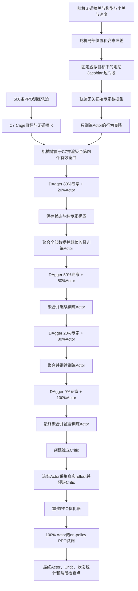

# 随机局部Jacobian专家—C7 DAgger—PPO训练链

## 固定契约

- Cage网络已经训练完成并冻结。
- Cage与PPO使用不同轨迹归档；当前PPO训练池为500条轨迹。
- 初始专家示范和行为克隆不读取轨迹、不使用C7，也不依赖视觉Cage网络。
- DAgger、Critic预热和正式PPO属于轨迹型阶段，均从第三个五帧窗口产生的C7无碰撞IK构型初始化机械臂。
- 初始化动作不写入监督样本或PPO transition。
- 完成第四个有效五帧视觉窗口后才产生第一条学习动作。
- Actor状态固定为Base下TCP到当前Cage的相对位置3维、最短旋转向量3维、关节角6维和关节速度6维。
- Actor动作固定为一次50 ms视觉事件对应的六维归一化关节增量。
- Jacobian专家只能读取当前Cage、当前TCP、当前关节角和关节速度，不能读取未来轨迹。

## 正式逻辑链



## 初始随机专家示范

初始行为克隆只学习“当前局部位姿误差如何转换为关节增量”，无需知道物体走哪条轨迹。每个短片段按以下方式构造：

1. 在UR5e名义构型附近分别扰动六个关节，并采样较小的初始关节速度。
2. 删除发生接触、越过关节安全边界或TCP超出工作空间的构型。
3. 以当前TCP为中心，独立随机采样局部位置误差方向、距离、姿态轴和姿态角，形成固定的虚拟Cage目标。
4. Jacobian专家连续执行最多若干个50 ms动作；达到局部误差阈值、碰撞或片段长度上限后重新随机初始化。
5. 保存每一步的18维当前状态和同一状态下的纯专家动作。按随机片段ID划分监督训练集和验证集，避免相邻状态跨集合。

默认位置误差覆盖5–45 mm，姿态误差覆盖1–15度，关节构型在名义姿态附近按关节分别扰动。这里有意不使用物体轨迹，使初始Actor覆盖更多关节构型、误差方向和局部Jacobian条件。

## DAgger及后续阶段的一条轨迹时间关系

1. 已知训练轨迹的第三个五帧窗口构造C7目标。
2. 使用UR5e解析多分支加MuJoCo数值修正求出C7无碰撞关节构型。
3. 将机械臂放到C7，清零关节速度；该操作在学习片段之外。
4. eye-on-hand从轨迹起点开始渲染，因果卡尔曼逐帧建立历史。
5. 第四个有效五帧窗口形成后，得到第一个动态Cage目标和18维相对状态。
6. DAgger阶段同时计算Actor动作与Jacobian动作，按照当前轮次权重平滑混合后执行。
7. 监督数据始终保存当前18维状态与纯Jacobian动作，不保存混合动作为标签。
8. 发生连续三帧视觉逃逸时结束当前学习片段，执行训练特权恢复并重新建立有效视觉历史。
9. 特权IK恢复不写入DAgger样本，也不写入PPO transition。

## 阻尼Jacobian专家

专家先将当前相对位置和姿态误差变成受限TCP线速度与角速度，再读取MuJoCo当前site Jacobian，使用奇异值相关阻尼得到关节速度。随后结合当前关节速度做阻尼反馈，并执行关节居中、速度限制和50 ms单步增量限制，最终转换为与Actor完全相同的六维归一化动作。因此随机示范中的小关节速度会真实影响专家标签，而不是成为无效随机特征。

专家是运动学教师，不替代MuJoCo动力学。示范和DAgger的实际动作仍由MuJoCo位置执行器积分，因而采集状态包含惯性、执行滞后和关节耦合。每个MuJoCo底层积分步对六个机器人自由度补偿重力、科氏力和离心偏置力，以匹配真实UR控制器位于策略层之下的模型补偿；接触、惯性和执行器动态本身仍由MuJoCo计算。随机示范、DAgger、PPO训练和MuJoCo推理共用这一执行路径。

## 行为克隆与DAgger更新

- 随机局部示范完成后，更新18维状态运行统计，只训练Actor特征层和均值头。
- 六个关节联合计算一个监督损失，不能拆成六个互不相关的策略。
- 每一轮DAgger完成后，把新状态和纯专家标签追加到已有数据，再用全部聚合数据继续训练Actor。
- 初始示范按随机片段ID划分；进入DAgger后再按轨迹ID分组，避免同一连续片段的相邻状态同时进入训练和验证。
- 每轮保存Actor检查点，最后一轮必须是0%专家，确认Actor产生自己的状态分布。
- 聚合文件同时保存样本来源：负分组ID表示随机局部片段，非负分组ID表示C7视觉轨迹，便于检查两个阶段没有被混淆。

## Critic预热和PPO边界

Critic使用独立网络，不与Actor共享特征主干。行为克隆和DAgger期间Critic不更新。DAgger结束后使用当前Actor采集真实MuJoCo rollout，以折扣回报预热Critic；随后清空专家阶段的Adam动量并创建正式PPO优化器。

正式PPO中只能执行当前Actor采样的动作。Jacobian动作、混合动作和IK恢复都不能写入PPO rollout，否则旧策略对数概率与实际动作不一致。每个动作仍由产生该状态的同一个Cage目标评价，下一帧视觉产生的Cage只属于下一状态。

程序在每次DAgger、Critic预热和正式PPO episode reset后核对重置窗口号必须为3、首个策略窗口号必须为4；任一阶段没有返回C7契约会立即停止训练。初始随机示范则在检查点中明确记录“不使用轨迹、不使用视觉、不调用Cage网络、不使用C7”。

推理加载器只接受本节定义的新专家初始化契约或显式的纯随机Actor/Critic对照契约；旧“初始示范也从C7开始”的检查点会被拒绝，不能与新策略混用。

## 输出结构

若最终输出为`artifacts/production_curved/ppo2_expert.pt`，阶段文件位于：

```text
artifacts/production_curved/
├── ppo2_expert.pt
├── ppo2_expert_checkpoints/
│   ├── update_0050.pt
│   └── training_history.jsonl
└── ppo2_expert_expert_stages/
    ├── actor_bc.pt
    ├── dagger_01.pt
    ├── dagger_02.pt
    ├── dagger_03.pt
    ├── dagger_04.pt
    ├── critic_warmup.pt
    ├── aggregated_expert_dataset.npz
    └── expert_history.jsonl
```

## 正式训练命令

```bash
python -m cage_system.cli train-ppo \
  --config configs/production_curved_ppo.yaml \
  --cage-checkpoint artifacts/production_curved/cage_point20.pt \
  --trajectories artifacts/production_curved/ppo_trajectories.npz \
  --mujoco-model assets/mujoco_menagerie/universal_robots_ur5e/scene_eye_on_hand.xml \
  --tcp-site attachment_site \
  --output artifacts/production_curved/ppo2_expert.pt \
  --device auto
```

`expert_training.enabled: true`时同一条`train-ppo`命令自动执行完整专家链；设为`false`时跳过专家阶段，可构建相同状态、动作、奖励和轨迹条件下的随机初始化PPO基线。JAiLeR完整对照还需要另外启用其由小到大的目标区域课程，不能只靠关闭专家阶段冒充论文方法。
