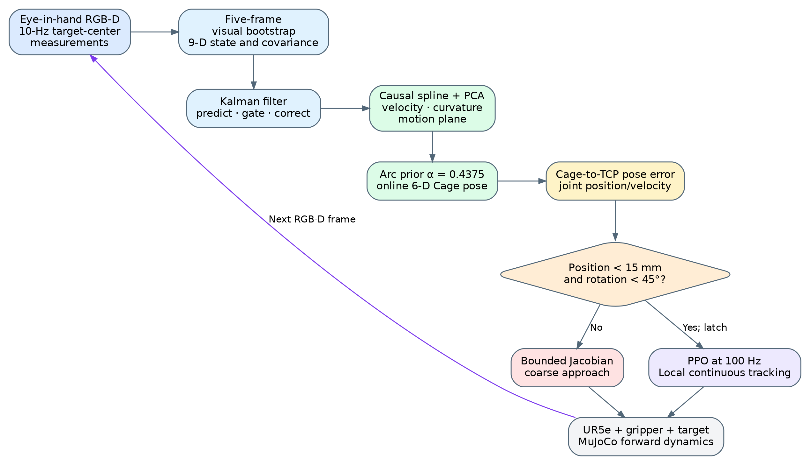
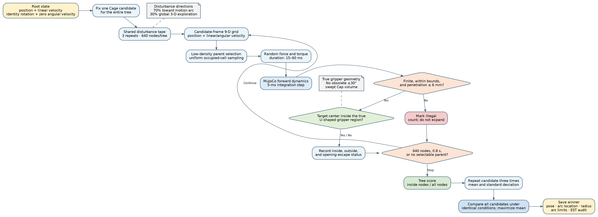
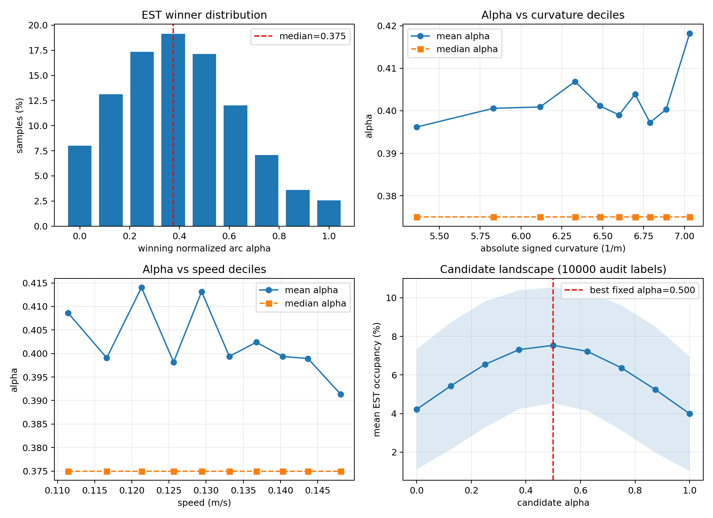
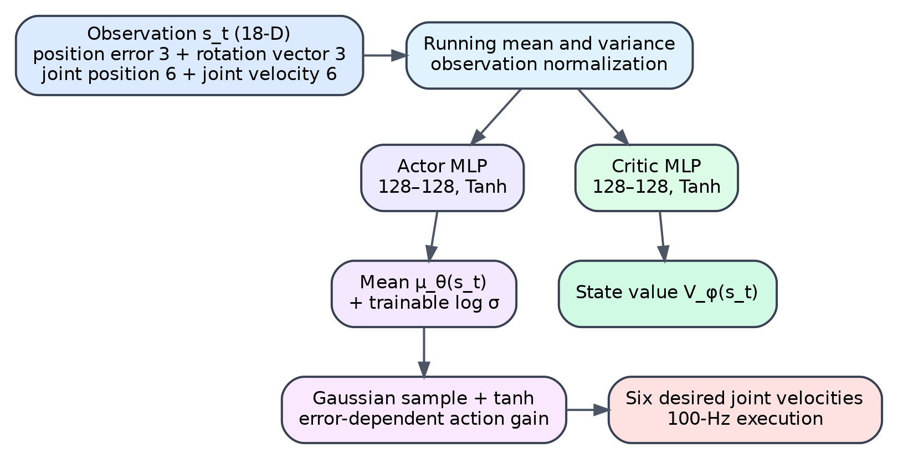
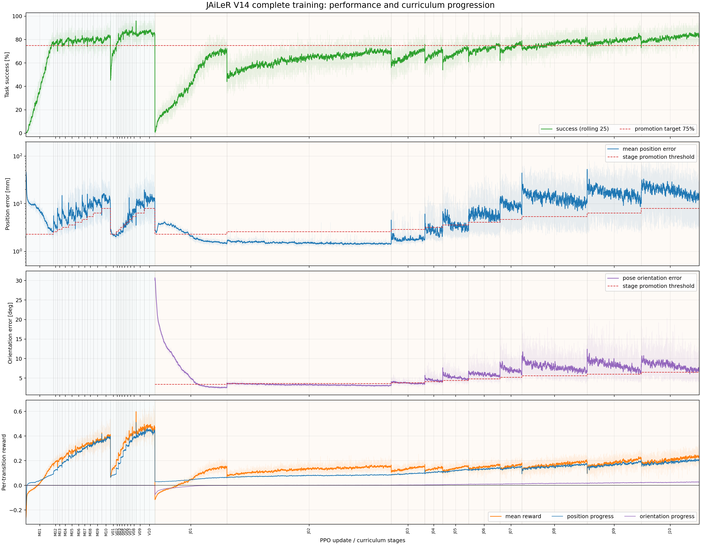
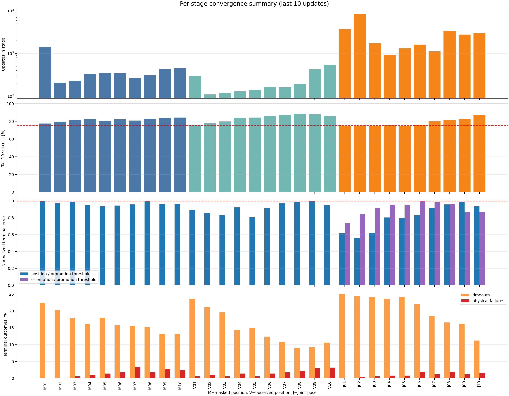
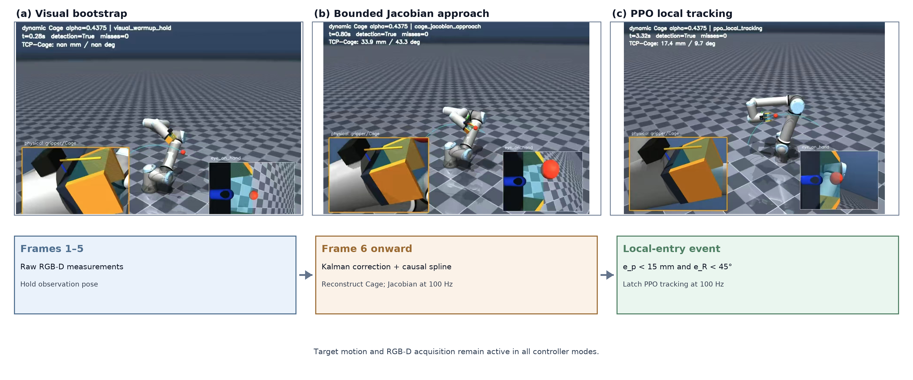

# Dynamic Cage Reconstruction and Curriculum Reinforcement Learning for Continuous Tracking of Moving Targets

<!-- IEEE author names, affiliations, and e-mail addresses intentionally left blank -->

**Abstract—** Before grasping a moving object, a robot must keep its open gripper in a capture-favorable relative pose while preserving eye-in-hand visibility and responding to changes in the object's speed and curvature. Directly commanding the end effector toward the latest detected center ignores the motion trend: sensing and actuation delay then produce persistent lag, and the target may leave the camera view. Moreover, the measured center alone does not determine which gripper position and orientation are most resistant to target disturbances. This paper addresses the causal reconstruction and continuous tracking of a dynamic Cage pose, defined as an open pre-grasp end-effector frame relative to a moving point target. Five color-and-depth observations bootstrap a nine-dimensional position–velocity–acceleration state. Kalman filtering, innovation gating, a causal local spline, and local principal-component analysis estimate the motion trend and plane without future trajectory information. Speed-dependent Cage candidates are constructed on a minor arc defined by the current tangent and locally extrapolated curve. Offline expansive-space-tree simulations score each fixed candidate by target-state occupancy inside the true U-shaped gripper region, yielding an online normalized arc prior. A bounded Jacobian controller performs coarse approach, followed by a proximal policy optimization policy that supplies 100-Hz local joint-velocity corrections. In a UR5e–MuJoCo case study with curved quasi-planar targets moving at 0.11–0.18 m/s, the best final-curriculum checkpoint achieved 92% rollout success, 2.95 mm mean terminal position error, and 3.94° mean terminal orientation error. The resulting framework provides an auditable path from causal visual estimation to dynamics-informed pre-grasp tracking.

**Index Terms—** Dynamic caging, eye-in-hand vision, moving-target tracking, reinforcement learning, robotic manipulation.

## I. INTRODUCTION

Continuous tracking of moving objects is a prerequisite for dynamic grasping, conveyor manipulation, noncooperative target capture, and human–robot interaction. In contrast to static reaching, the target continues to move between two visual observations. If the latest measured center is directly used as the end-effector reference, image-processing latency, discrete control, and robot inertia produce a persistent following error. In an eye-in-hand configuration, the same error can push the target outside the camera field of view, simultaneously breaking state estimation and control. Previous moving-target visual-servo systems compensate for this effect through velocity estimation or disturbance observers [1]–[3]. However, they do not directly answer two task-specific questions: where the end effector should be placed relative to the motion trend, and whether that relative pose remains favorable under dynamic disturbances.

This work addresses a pre-grasp tracking state rather than a closed grasp. The gripper maintains a finite offset and orientation relative to the moving target, keeping the target near an open, capture-favorable region. We call the corresponding desired end-effector frame a *Cage pose*. The Cage is related to the physical gripper but is not assumed to be a sealed geometric enclosure. Containment is evaluated only with the true U-shaped inner geometry of the gripper. In particular, the obsolete model obtained by sweeping the fingers through ±30° to form an artificial three-dimensional Cap volume is not used.

Differential Jacobian control provides fast and interpretable pose correction without policy training, but relies on local linearization and explicit handling of singularity, joint-limit, and rate constraints. Reinforcement learning can capture joint coupling, acceleration effects, and the interaction between position and orientation corrections. JAiLeR demonstrated that task-space goals can be mapped directly to joint-space control through deep reinforcement learning [4], while proximal policy optimization (PPO) provides a stable clipped update for continuous policies [5]. Asking one PPO policy to discover both long-range reaching and precise local following nevertheless creates an unnecessarily difficult exploration problem. The present system therefore assigns large-error approach to a bounded Jacobian controller and reserves PPO for high-rate local correction.

The main contributions are as follows.

1. A fully causal online reconstruction method estimates target position, velocity, acceleration, curvature, and the local motion plane using only current and past eye-in-hand depth observations.
2. A candidate-generation and dynamics-evaluation method places fixed Cage poses on a motion-consistent minor arc and uses expansive-space-tree (EST) propagation only for target-state expansion and candidate scoring under the true gripper geometry.
3. A hybrid Jacobian–PPO controller separates deterministic coarse approach from learned local tracking. The PPO policy observes a six-dimensional Cage-to-tool error and the twelve-dimensional robot joint state.
4. A reproducible pipeline connects trajectory synthesis, dynamics-based prior extraction, causal visual reconstruction, curriculum policy training, and closed-loop MuJoCo visualization.

**Fig. 1.** Overall causal pipeline. Vision updates at 10 Hz and joint control runs at 100 Hz. Five valid visual frames bootstrap the motion state; from frame six onward, the Cage is reconstructed online and the controller switches from bounded Jacobian approach to latched PPO tracking.

## II. RELATED WORK

### A. Moving-Target Visual Servoing

Eye-in-hand visual servoing closes the robot loop through image features or reconstructed three-dimensional pose error. For a moving target, target velocity acts as an external disturbance in feature dynamics; ignoring it results in a systematic lag. Ito and Shibata studied delay-free tracking of a moving target with a hand-eye robot [1]. Cervera *et al.* combined depth and motion-disturbance observation for robotic visual servoing [2]. Dong and Zhu coupled adaptive extended Kalman estimation with eye-in-hand capture of a noncooperative target [3]. These studies motivate separating measurement filtering, motion estimation, and control-reference generation. The present work further maps the estimated motion into a directional Cage pose rather than using the object center as the tool-center-point (TCP) reference.

### B. Caging and Dynamics-Based Robustness

Caging restricts object escape through geometry without requiring force closure. *Caging in Motion* extended quasi-static caging to contact-rich dynamic manipulation and analyzed robustness through forward dynamics and energy margins [6]. The present formulation does not reuse its energy-margin or capture-set definition. Instead, each candidate gripper pose is held fixed while the current target state is expanded by EST. Nodes are classified by the true internal region of the gripper, and the complete-tree occupancy ratio is used as the candidate score.

EST originates from sampling-based planning in expansive spaces [7]. It favors parent nodes from sparsely occupied regions and therefore reduces concentration in a small portion of state space. Here, EST is not a robot path planner. It is an identical-condition dynamics stress test applied independently to Cage candidates.

### C. Learned Joint-Space Control

Inverse kinematics and Jacobian methods depend on an explicit kinematic model and require additional treatment of singularities, joint limits, and redundant solutions. Kumar *et al.* used deep reinforcement learning to map task-space errors to joint-space control and demonstrated the feasibility of learned reaching [4]. PPO limits each policy update through a clipped probability ratio [5], and generalized advantage estimation (GAE) balances bias and variance in policy-gradient estimation [8]. Building on these ideas, our controller uses a finer curriculum, independent Actor and Critic optimizers, error-dependent action scaling, and an online Jacobian–PPO mode switch.

## III. PROBLEM FORMULATION AND SYSTEM ARCHITECTURE

### A. Coordinate Frames and Objective

All frames are right-handed. Let \(\{B\}\), \(\{T\}\), \(\{C\}\), and \(\{K\}\) denote the robot base, TCP, Cage, and camera frames, respectively. The physical gripper and eye-in-hand camera are rigidly attached to the sixth UR5e link; hence \({}^{T}\mathbf{T}_{C}\) and \({}^{T}\mathbf{T}_{K}\) are fixed extrinsic transformations. A target-center measurement is transformed from the camera frame to the base frame by

$$
{}^{B}\mathbf{p}_{o,k}={}^{B}\mathbf{T}_{K,k}
\begin{bmatrix}{}^{K}\mathbf{p}_{o,k}\\1\end{bmatrix}.
\tag{1}
$$

The target is represented by a point-mass proxy with mass, collision radius, and contact parameters. Online reconstruction uses only its three-dimensional center; target orientation is not estimated. At every accepted visual update, the perception module generates a desired Cage pose \({}^{B}\mathbf{T}_{C,k}^{*}\). The robot must track this pose while preserving target visibility and satisfying joint and collision constraints.

### B. Multi-Rate Closed Loop

The eye-in-hand camera provides an observation every 100 ms. MuJoCo uses a 2-ms physics step, and the manipulator controller runs at 100 Hz, i.e., five physics steps per control command. Target motion is independent of policy inference: in simulation, the target follows a generated trajectory that is hidden from the online estimator, while the controller can access only camera measurements, robot forward kinematics, and causal filter history.

The state machine has three modes. During the first five valid frames, the arm holds an observation pose and collects raw measurements. From the sixth frame onward, the system reconstructs the Cage and uses the bounded Jacobian controller for approach. Once the TCP-to-Cage position error is below 15 mm and the shortest-rotation error is below 45°, PPO is enabled and latched for local tracking. One missed detection invokes Kalman prediction only; three consecutive misses terminate the current task as a loss of visual tracking.

**TABLE I**

**CORE SYSTEM RATES AND DIMENSIONS**

| Quantity | Value |
|---|---:|
| Visual update interval | 100 ms (10 Hz) |
| Joint-control interval | 10 ms (100 Hz) |
| MuJoCo integration step | 2 ms |
| Kalman state dimension | 9 |
| PPO observation/action dimensions | 18 / 6 |
| Jacobian-to-PPO switch | 15 mm and 45° |

## IV. METHOD

### A. Causal Nine-Dimensional Motion Estimation

#### 1) Five-Frame Bootstrap

The target state contains position, velocity, and acceleration,

$$
\mathbf{x}_k=
\begin{bmatrix}
\mathbf{p}_k^{\mathsf T}&\mathbf{v}_k^{\mathsf T}&\mathbf{a}_k^{\mathsf T}
\end{bmatrix}^{\mathsf T}\in\mathbb{R}^{9}.
\tag{2}
$$

The filter is not initialized from a single measurement with arbitrarily zero velocity and acceleration. Instead, five valid target centers are fit with a local quadratic motion model to estimate \(\mathbf{p}_5\), \(\mathbf{v}_5\), and \(\mathbf{a}_5\). The fit residual initializes \(\mathbf{P}_5\): a larger residual yields larger uncertainty in the corresponding position, velocity, and acceleration components. Standard-deviation floors of 3 mm, 0.03 m/s, and 0.20 m/s² prevent overconfident initialization. Consequently, the first innovation test at frame six uses a motion state supported by actual visual history.

#### 2) Constant-Acceleration Kalman Filter

For sampling interval \(\Delta t\), the constant-acceleration Kalman prediction [11] is

$$
\mathbf{x}_{k|k-1}=\mathbf{F}(\Delta t)\mathbf{x}_{k-1|k-1},\qquad
\mathbf{P}_{k|k-1}=\mathbf{F}\mathbf{P}_{k-1|k-1}\mathbf{F}^{\mathsf T}+\mathbf{Q}(\Delta t),
\tag{3}
$$

with

$$
\mathbf{F}(\Delta t)=
\begin{bmatrix}
\mathbf{I}&\Delta t\mathbf{I}&\frac{1}{2}\Delta t^2\mathbf{I}\\
\mathbf{0}&\mathbf{I}&\Delta t\mathbf{I}\\
\mathbf{0}&\mathbf{0}&\mathbf{I}
\end{bmatrix}.
\tag{4}
$$

The process covariance follows an integrated white-jerk model, allowing acceleration to change smoothly rather than remain constant indefinitely. The depth detector directly measures position only,

$$
\mathbf{z}_k=\mathbf{H}\mathbf{x}_k+\boldsymbol{\nu}_k,\qquad
\mathbf{H}=\begin{bmatrix}\mathbf{I}&\mathbf{0}&\mathbf{0}\end{bmatrix},
\tag{5}
$$

where \(\boldsymbol{\nu}_k\sim\mathcal{N}(\mathbf{0},\mathbf{R})\). Let \(\mathbf{y}_k=\mathbf{z}_k-\mathbf{H}\mathbf{x}_{k|k-1}\) and \(\mathbf{S}_k\) be the innovation and its covariance. A measurement is accepted only if its squared Mahalanobis distance

$$
d_k^2=\mathbf{y}_k^{\mathsf T}\mathbf{S}_k^{-1}\mathbf{y}_k
\tag{6}
$$

is below the innovation-gate threshold. A missed or rejected observation does not erase the accumulated state; the filter retains the prediction with increased uncertainty.

### B. Causal Curve and Local Motion Plane

A shared three-dimensional cubic spline is fitted over a finite causal window by minimizing a recency-weighted data term and a curvature regularizer,

$$
\min_{\mathbf{c}}
\sum_i w_i\|\mathbf{s}(t_i;\mathbf{c})-\hat{\mathbf{p}}_i\|_2^2
+\lambda\int\|\mathbf{s}''(t)\|_2^2\,dt.
\tag{7}
$$

Recent measurements receive larger weights. The first and second derivatives provide local velocity and acceleration, while curvature is

$$
\kappa(t)=\frac{\|\dot{\mathbf{s}}(t)\times\ddot{\mathbf{s}}(t)\|_2}
{\|\dot{\mathbf{s}}(t)\|_2^3}.
\tag{8}
$$

The spline uses only samples at or before the current time. Its forward continuation is a prediction of the current local model, not access to the generated trajectory's future ground truth.

Principal-component analysis [12] is applied to spline samples in the causal window. When the ratio between the second and first eigenvalues indicates sufficient two-dimensional spread, the eigenvector associated with the smallest eigenvalue defines the plane normal. For sufficiently curved motion, \(\mathbf{t}\times\mathbf{a}\) also supplies a differential normal. The sign is stabilized against the previous normal and a base-frame reference, and the maximum frame-to-frame normal rotation is limited to avoid eigenvector sign flips.

### C. Cage Candidates and Offline EST Evaluation

#### 1) Speed-Dependent Radius

The candidate-circle radius grows linearly with the estimated target speed and is limited to 0.10–0.18 m,

$$
r_k=\operatorname{LPF}\!\left[
\operatorname{clip}\!\left(
r_{\min}+\frac{v_k-v_{\min}}{v_{\max}-v_{\min}}
(r_{\max}-r_{\min}),r_{\min},r_{\max}
\right)\right].
\tag{9}
$$

A low-pass filter and a radius-rate limit prevent visual velocity noise from producing discontinuous Cage poses. The larger radius at higher speed reserves more response distance and camera visibility.

#### 2) Minor Arc and Candidate Orientation

Let the current target position be the circle center, and let \(\mathbf{u}_k\) and \(\mathbf{v}_k\) span the local motion plane. The arc starts where the current tangent intersects the radius circle and ends at the first intersection between the forward continuation of the causal spline and the same circle. A normalized arc coordinate \(\alpha\in[0,1]\) reconstructs the candidate position as

$$
\theta(\alpha)=\theta_s+\alpha(\theta_e-\theta_s),\qquad
\mathbf{p}_{C}(\alpha)=\mathbf{p}_k+r_k
[\cos\theta(\alpha)\mathbf{u}_k+\sin\theta(\alpha)\mathbf{v}_k].
\tag{10}
$$

The candidate Cage \(x\)-axis always points from the candidate toward the object center. Its \(z\)-axis is the stabilized positive motion-plane normal, and the \(y\)-axis completes a right-handed frame. Thus the Cage \(x\)-\(y\) plane is parallel to the local target-motion plane, while the planes of the two gripper fingers are normal to the Cage \(y\)-axis.

#### 3) EST Dynamics Expansion

For each candidate, the pose remains fixed and the EST root contains the current target position, linear velocity, identity orientation, and zero angular velocity. A parent is preferentially drawn from a low-density cell, then a random force, random torque, and random duration are applied. MuJoCo performs physical forward integration with a 5-ms step. Seventy percent of force directions are biased toward the current motion-arc sector, while 30% retain global three-dimensional exploration. Each tree contains at most 640 nodes over 0.8 s. Nonfinite states, boundary violations, and penetration exceeding 6 mm are marked illegal and are not expanded further.

**Fig. 2.** Dynamics evaluation of one fixed candidate. EST expands only target states; candidate pose and gripper geometry remain unchanged during a tree. All candidates share the same disturbance tape.

For candidate \(j\) and repeat \(m\), let \(N_{j,m}^{\mathrm{in}}\) be the number of nodes inside the physical U-shaped gripper region and \(N_{j,m}\) the total number of tree nodes. The occupancy and three-repeat statistics are

$$
\rho_{j,m}=\frac{N_{j,m}^{\mathrm{in}}}{N_{j,m}},\qquad
\bar{\rho}_j=\frac{1}{3}\sum_{m=1}^{3}\rho_{j,m},\qquad
\sigma_j=\operatorname{Std}(\rho_{j,1},\rho_{j,2},\rho_{j,3}).
\tag{11}
$$

The primary label is the candidate with maximum \(\bar{\rho}_j\); continuity is considered only for a near tie. The internal region is bounded by the true back wall, opening, inter-finger width, and height. Escape through the opening is explicitly recorded, and no artificial Cap surface is introduced.

#### 4) From EST Labels to an Online Prior

The offline state–arc data contain 55,121 valid labels from 2,919 trajectories. The winning \(\alpha\) has mean 0.402 and median 0.375. An audit of all candidates for 10,000 labels shows that the largest mean occupancy is obtained by fixed \(\alpha=0.5\). Meanwhile, the absolute Pearson correlations between winning \(\alpha\) and speed, curvature, acceleration, or radius are all below 0.02. Under the present geometry and disturbance model, these state variables therefore provide little evidence for a reliable regressor. The online system uses \(\alpha=0.4375\), the midpoint between the empirical median and the occupancy-maximizing fixed candidate.

**Fig. 3.** Offline EST statistics. Winners cluster around the middle of the minor arc, while their dependence on speed and curvature is weak. The fixed prior is therefore better supported by the current data than a learned arc regressor.

### D. Bounded Jacobian Approach and PPO Tracking

#### 1) Differential Jacobian Controller

The desired Cage pose and current TCP pose define \(\mathbf{e}=[\mathbf{e}_p,\mathbf{e}_R]\), where \(\mathbf{e}_R\) is the shortest rotation vector. Desired task-space velocity combines feedforward motion and proportional feedback,

$$
\boldsymbol{\xi}^{*}=\boldsymbol{\xi}_{\mathrm{ref}}+
\begin{bmatrix}k_p\mathbf{e}_p\\k_R\mathbf{e}_R\end{bmatrix}.
\tag{12}
$$

Joint velocity is obtained from a bounded damped least-squares problem [10],

$$
\dot{\mathbf{q}}^{*}=\arg\min_{\dot{\mathbf{q}}}
\|\mathbf{W}(\mathbf{J}\dot{\mathbf{q}}-\boldsymbol{\xi}^{*})\|_2^2
+\lambda_J\|\dot{\mathbf{q}}\|_2^2,
\quad
\dot{\mathbf{q}}_{\min}\leq\dot{\mathbf{q}}\leq\dot{\mathbf{q}}_{\max}.
\tag{13}
$$

The bounds jointly enforce joint speed, acceleration, and remaining position margin. This controller supplies a predictable descent direction when the robot starts far from the reconstructed Cage.

#### 2) PPO Observation, Action, and Probability Density

The PPO observation is

$$
\mathbf{s}_t=
\begin{bmatrix}
{}^{B}\mathbf{e}_{p,t}^{\mathsf T}&
\mathbf{e}_{R,t}^{\mathsf T}&
\mathbf{q}_t^{\mathsf T}&
\dot{\mathbf{q}}_t^{\mathsf T}
\end{bmatrix}^{\mathsf T}\in\mathbb{R}^{18}.
\tag{14}
$$

Actor and Critic are separate two-layer, 128-unit hyperbolic-tangent multilayer perceptrons with independent parameters and Adam optimizers. The Actor outputs a six-dimensional Gaussian mean, while six global \(\log\sigma\) parameters are trained with the policy. A latent action is sampled and squashed,

$$
\mathbf{u}_t\sim\mathcal{N}(\boldsymbol{\mu}_{\theta}(\mathbf{s}_t),
\operatorname{diag}(\boldsymbol{\sigma}_{\theta}^{2})),\qquad
\mathbf{a}_t=\tanh(\mathbf{u}_t).
\tag{15}
$$

The log density includes the Jacobian correction for the nonlinear transformation,

$$
\log\pi_{\theta}(\mathbf{a}_t|\mathbf{s}_t)=
\log\mathcal{N}(\operatorname{atanh}(\mathbf{a}_t);\boldsymbol{\mu}_{\theta},\boldsymbol{\sigma}_{\theta})
-\sum_i\log(1-a_{t,i}^{2}+\epsilon).
\tag{16}
$$

The executed joint velocity is additionally multiplied by an error-dependent gain \(g_t\). Position and rotation errors are normalized by the current curriculum success thresholds, and the more severe normalized error is mapped through a piecewise-linear schedule from 0.1 to 1.0,

$$
g_t=\min\!\left(g_{\mathrm{stage}},
\operatorname{interp}\!\left[
\max\!\left(\frac{\|\mathbf{e}_{p,t}\|}{\delta_p},
\frac{\|\mathbf{e}_{R,t}\|}{\delta_R}\right)
\right]\right).
\tag{17}
$$

**Fig. 4.** Actor–Critic structure and action execution. The policy outputs normalized joint velocities; error-dependent scaling preserves small corrections near the target while permitting faster motion at larger errors.

#### 3) Frozen Rollout Targets and Independent Updates

After each rollout, temporal-difference residuals and GAE are computed once using a frozen old value function,

$$
\delta_t=r_t+\gamma(1-d_t)V_{\mathrm{old}}(s_{t+1})-V_{\mathrm{old}}(s_t),\qquad
\hat{A}_t=\sum_{l=0}^{T-t-1}(\gamma\lambda)^l\delta_{t+l}.
\tag{18}
$$

The advantages and value targets

$$
\hat{V}_t=V_{\mathrm{old}}(s_t)+\hat{A}_t
\tag{19}
$$

remain fixed throughout all minibatch epochs of the update. The Actor maximizes the clipped surrogate objective with entropy regularization,

$$
J_{\pi}(\theta)=\mathbb{E}_t\!\left[
\min\!\left(r_t(\theta)\hat{A}_t,
\operatorname{clip}(r_t(\theta),1-\epsilon,1+\epsilon)\hat{A}_t\right)
+\beta\mathcal{H}(\pi_{\theta})
\right],
\tag{20}
$$

where \(r_t(\theta)=\pi_{\theta}(a_t|s_t)/\pi_{\mathrm{old}}(a_t|s_t)\). If approximate Kullback–Leibler divergence exceeds its threshold, Actor epochs stop early; the independently optimized Critic still completes its regression,

$$
L_V(\phi)=\frac{1}{2}\mathbb{E}_t[(V_{\phi}(s_t)-\hat{V}_t)^2].
\tag{21}
$$

#### 4) Curriculum and Reward

Training uses 50 logical slots that share one UR5e model definition but maintain independent MuJoCo states and randomized tasks. Thirty stages are used. Ten masked-position stages learn reaching over 6–150 mm without orientation input. Ten observed-position stages expose orientation inputs while retaining a position objective, allowing normalization and network adaptation. Ten joint-pose stages expand from 20 mm/5° to 150 mm/45° and optimize both position and orientation. Promotion uses equally weighted completed tasks over the latest update window rather than repeatedly counting short, easy tasks.

Position quality combines a success-threshold-scaled exponential term and a long-tail inverse-quadratic term,

$$
Q_p=0.7\exp\!\left[-\ln 2\left(\frac{e_p}{\delta_p}\right)^2\right]
+0.3\frac{1}{1+(e_p/e_{p,\max})^2}.
\tag{22}
$$

Orientation quality compares three 5-cm virtual markers anchored at a common origin, so translational error is not counted twice,

$$
Q_R=\frac{1}{1+k_R E_{\mathrm{marker}}}.
\tag{23}
$$

Position and orientation weights are adjusted according to their normalized urgency. A component already inside its success region retains a small quality weight but receives no additional positive progress reward. The per-step reward is

$$
r_t=0.1(Q_t-1)
+2w_p\operatorname{clip}\!\left(\frac{e_{p,t-1}-e_{p,t}}{5\ \mathrm{mm}},-1,1\right)
+4w_R\operatorname{clip}\!\left(\frac{e_{R,t-1}-e_{R,t}}{\Delta_R},-1,1\right)
-\lambda_a C_a+R_{\mathrm{term}}.
\tag{24}
$$

Success yields +10. Collision, boundary violation, or a nonfinite state yields −10 plus the discounted baseline cost of the remaining steps, preventing the agent from escaping step costs by failing early. A time limit is treated as a rollout boundary rather than a physical terminal state, so GAE bootstraps from the next-state value.

## V. EXPERIMENTS

### A. Simulation and Training Configuration

Experiments use the UR5e model in MuJoCo [9] with `attachment_site` as the TCP. A rigid U-shaped gripper and eye-in-hand camera are attached to the terminal link. The target is a sphere proxy with mass, radius, and contact parameters. Dynamic trajectories last 5–7 s, use speeds of 0.11–0.18 m/s with 10%–20% smooth modulation, and span 0.55–0.75 m. Their local curvature changes smoothly without deliberately inserted curvature reversals. Candidate trajectories are filtered by base distance, height, workspace openness, and full-trajectory visibility.

The final PPO configuration uses \(\gamma=0.99\), \(\lambda=0.95\), clip parameter 0.2, Actor learning rate \(2\times10^{-5}\), Critic learning rate \(10^{-4}\), and minibatches of 512 samples. Each update permits eight Actor epochs and twelve Critic epochs. Entropy coefficients decay within each curriculum stage, with limited exploration recovery only after a sustained plateau and a sufficiently predictive Critic.

### B. Metrics and Evidence Boundaries

Training records completed-task success, terminal position and orientation errors, steps to reach, action saturation, Critic explained variance, and net TCP displacement over 50 and 100 ms. Dynamic inference is currently evaluated qualitatively through controller-mode transitions, continuous target visibility, and the complete MuJoCo motion sequence. Training rollout statistics are not presented as dynamic generalization results.

### C. Curriculum Training Results

The complete run performed 34,745 updates and passed all 30 curriculum stages. Stage transitions enlarge the task distribution and therefore cause expected temporary error increases, after which success recovers. The best checkpoint in the final J10 stage occurs at update 34,547. It achieves 92% equally weighted completed-task success, 2.95 mm mean and 4.00 mm 95th-percentile terminal position error, 3.94° mean and 4.83° 95th-percentile terminal orientation error, 1.97% action saturation, and 0.997 post-update Critic explained variance.

**TABLE II**

**FINAL-CURRICULUM BEST-CHECKPOINT RESULTS**

| Metric | Result |
|---|---:|
| Completed-task success | 92% |
| Terminal position error, mean / P95 | 2.95 / 4.00 mm |
| Terminal orientation error, mean / P95 | 3.94° / 4.83° |
| Action saturation | 1.97% |
| Critic explained variance | 0.997 |

**Fig. 5.** Complete curriculum training. From top to bottom: completed-task success, position error, orientation error, and mean/progress rewards. Abrupt changes correspond to deliberate task-distribution expansion.

**Fig. 6.** Per-stage summary over the last ten updates. Masked-position, observed-position, and joint-pose stages progressively expand the target range while retaining the 75% promotion objective.

### D. Online Inference Sequence

Fig. 7 combines three representative frames with the causal switching logic. In Fig. 7(a), only raw measurements are accumulated and the robot holds its observation pose. At frame six, Fig. 7(b), the initialized Kalman state and causal spline reconstruct a Cage pose, and the bounded Jacobian controller reduces the large error. Once the local-entry thresholds have been met, Fig. 7(c), PPO is latched and supplies continuous joint-velocity corrections while target motion and camera acquisition continue independently.

**Fig. 7.** Online inference sequence and switching logic. The three compact panels show the global MuJoCo view, the physical gripper/Cage inset, and the eye-in-hand view; the lower state strip summarizes the causal transition conditions.

At this stage, online inference demonstrates executable integration of continuous target motion, persistent RGB-D acquisition, five-frame state bootstrap, Cage reconstruction, and Jacobian-to-PPO transition. Dynamic TCP-to-Cage error distributions and cross-trajectory success are intentionally deferred until a fixed evaluation suite and unified logging protocol are available.

### E. Interpretation

The training results support the intended division of labor. PPO is optimized for repeated local correction, whereas the Jacobian controller supplies an explicit descent direction over large errors. The fixed \(\alpha=0.4375\) prior avoids adding regression error when the current EST data show almost no predictable state dependence. Online computation is therefore limited to motion filtering, causal curve fitting, plane estimation, one Cage reconstruction, and control.

## VI. DISCUSSION AND LIMITATIONS

The evidence supports the engineering rationale for a hybrid controller, but it does not yet establish robust capture over arbitrary dynamic trajectories. First, the current experiments use MuJoCo and color/depth-based target segmentation. A real detector will introduce class errors, exposure changes, missing depth, and calibration drift. Second, the fixed arc prior is specific to the present gripper, object proxy, disturbance distribution, and speed range; changing these conditions requires a new EST audit. Third, PPO is trained on locally sampled Cage goals, whereas the online reference changes continuously, leaving a simulation-to-task distribution gap. Fourth, three missed frames currently define visual failure without distinguishing occlusion, field-of-view loss, invalid depth, and detector failure.

Future experiments will use a fixed seed suite stratified by trajectory height, direction, curvature, and initial error; compare Jacobian-only, PPO-only, no-filter, and no-EST-prior variants; validate hand-eye calibration and ROS control on a physical UR5e; and reevaluate whether a fixed arc prior remains adequate for diverse object and gripper geometries.

## VII. CONCLUSION

This paper presented a causal dynamic-Cage reconstruction and hybrid Jacobian–PPO controller for continuous tracking of moving targets. Five eye-in-hand observations initialize a nine-dimensional motion state; Kalman filtering, a causal spline, and local principal-component analysis then estimate motion without future ground truth. Cage candidates follow a speed-dependent minor arc, while offline EST propagation compares them through identical dynamic disturbances and the true U-shaped gripper region. A bounded Jacobian controller handles coarse approach, and a curriculum-trained PPO policy performs local joint-velocity tracking. The final curriculum checkpoint achieved high local reach accuracy over initial errors up to 150 mm and 45°, and the integrated visualization confirmed the complete online state sequence. The next experimental priority is a standardized dynamic benchmark followed by real-camera and real-robot validation.

## REFERENCES

[1] M. Ito and M. Shibata, “Image-based visual tracking control of hand-eye robot for moving target object,” *IEEJ Trans. Ind. Appl.*, vol. 129, no. 9, pp. 930–937, 2009, doi: 10.1541/ieejias.129.930.

[2] E. Cervera, A. P. del Pobil, F. Berry, and P. Martinet, “Robotic visual servoing of moving targets,” in *Proc. IEEE/RSJ Int. Conf. Intell. Robots Syst. (IROS)*, 2013, doi: 10.1109/IROS.2013.6696335.

[3] G. Dong and Z. H. Zhu, “Autonomous robotic capture of non-cooperative target by adaptive extended Kalman filter based visual servo,” *Acta Astronaut.*, vol. 122, pp. 209–218, 2016, doi: 10.1016/j.actaastro.2016.02.003.

[4] V. Kumar, D. Hoeller, B. Sundaralingam, J. Tremblay, and S. Birchfield, “Joint space control via deep reinforcement learning,” in *Proc. IEEE/RSJ Int. Conf. Intell. Robots Syst. (IROS)*, 2021.

[5] J. Schulman, F. Wolski, P. Dhariwal, A. Radford, and O. Klimov, “Proximal policy optimization algorithms,” arXiv:1707.06347, 2017.

[6] Y. Dong, X. Cheng, and F. T. Pokorny, “Caging in motion: Characterizing robustness in manipulation through energy margin and dynamic caging analysis,” arXiv:2404.12115, 2024.

[7] D. Hsu, J.-C. Latombe, R. Motwani, and S. Sorkin, “Path planning in expansive configuration spaces,” in *Proc. IEEE Int. Conf. Robot. Autom. (ICRA)*, pp. 2719–2726, 1997, doi: 10.1109/ROBOT.1997.619371.

[8] J. Schulman, P. Moritz, S. Levine, M. Jordan, and P. Abbeel, “High-dimensional continuous control using generalized advantage estimation,” arXiv:1506.02438, 2015.

[9] E. Todorov, T. Erez, and Y. Tassa, “MuJoCo: A physics engine for model-based control,” in *Proc. IEEE/RSJ Int. Conf. Intell. Robots Syst. (IROS)*, pp. 5026–5033, 2012, doi: 10.1109/IROS.2012.6386109.

[10] C. W. Wampler, “Manipulator inverse kinematic solutions based on vector formulations and damped least-squares methods,” *IEEE Trans. Syst., Man, Cybern.*, vol. 16, no. 1, pp. 93–101, 1986.

[11] R. E. Kalman, “A new approach to linear filtering and prediction problems,” *J. Basic Eng.*, vol. 82, no. 1, pp. 35–45, 1960.

[12] I. T. Jolliffe, *Principal Component Analysis*, 2nd ed. New York, NY, USA: Springer, 2002.
