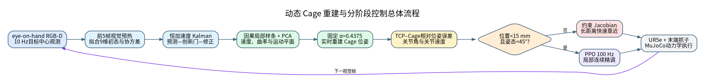
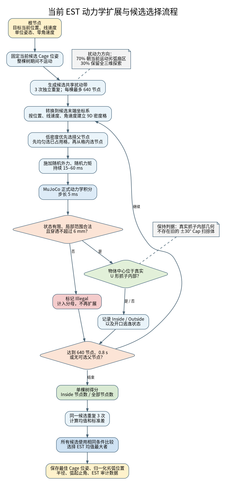
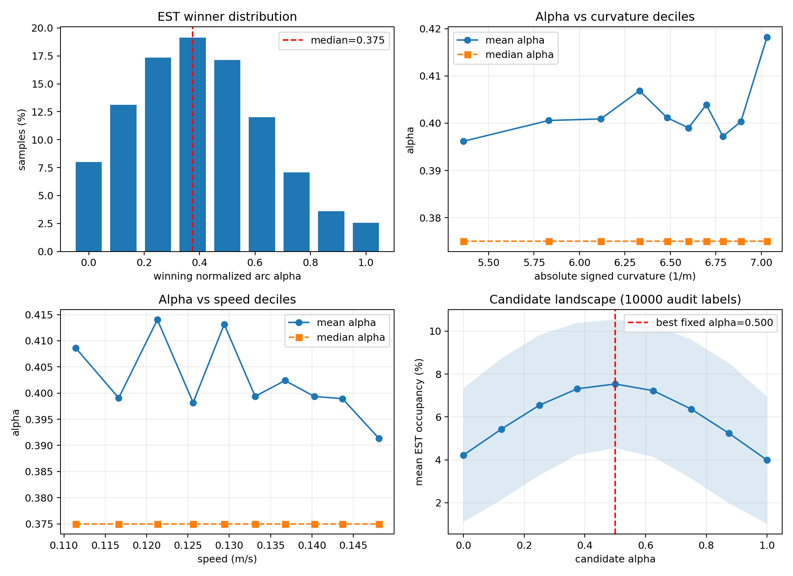
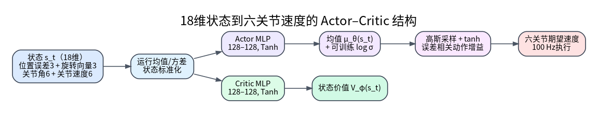
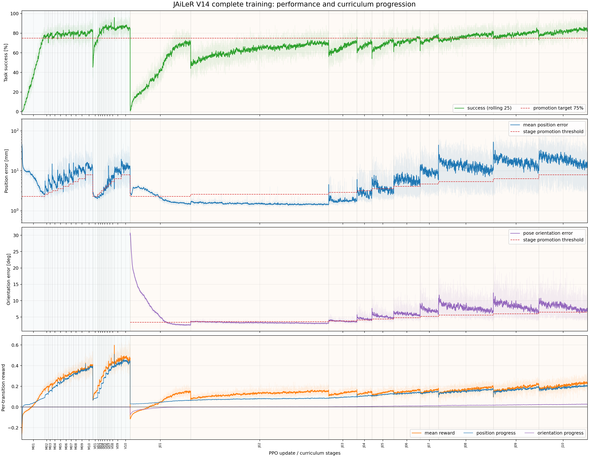
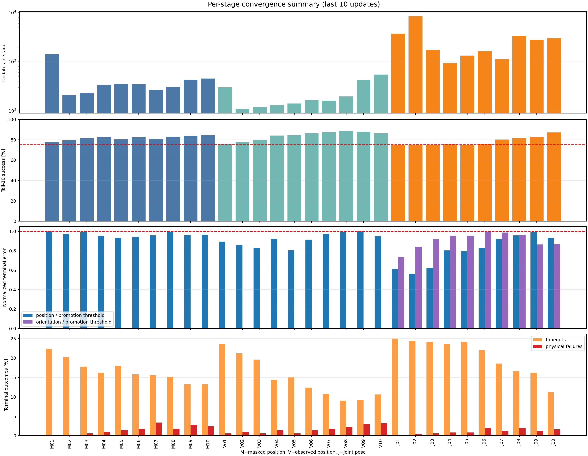
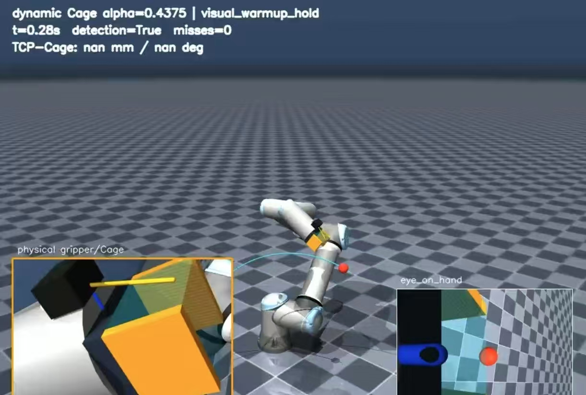
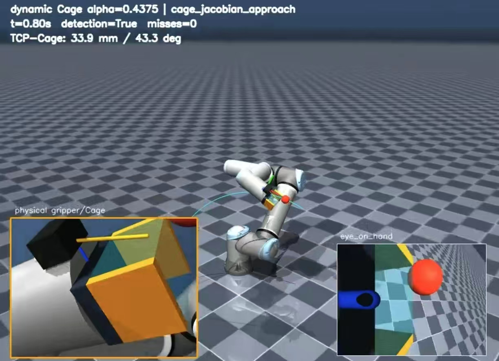
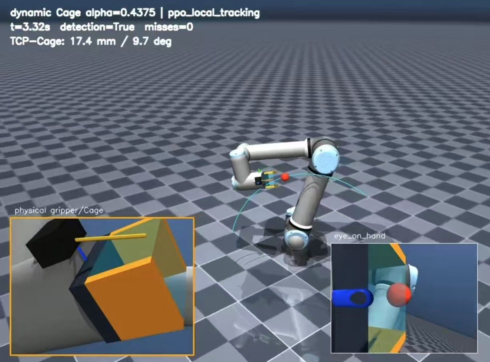

# 基于动态 Cage 重建与课程强化学习的机械臂运动目标连续跟踪方法

<!-- IEEE作者信息区域预留：姓名、单位、邮箱暂不填写 -->

**摘要—** 面向运动目标的机械臂连续跟踪与待抓取保持任务，仅追踪目标当前坐标会使末端长期滞后于目标，并且难以同时保证目标可见性、机械臂可达性和抓子朝向的连续性。针对这一问题，本文提出一种由视觉状态估计、动态 Cage 位姿重建和分阶段机械臂控制组成的闭环方法。首先，利用末端 eye-on-hand RGB-D 相机获得目标中心的三维观测，以五帧原始观测拟合九维位置—速度—加速度初态，随后通过恒加速度 Kalman 滤波、创新门和因果局部样条持续估计目标运动状态；再利用局部轨迹的主成分分析与微分几何信息估计运动平面，根据速度自适应设置候选半径，并在当前切线与局部延展曲线共同确定的劣弧上重建 Cage 位姿。离线阶段，以目标状态为 EST 根节点，在相同扰动条件下对不同候选执行 MuJoCo 动力学扩展，以真实 U 形抓子内部区域的节点占有率评价候选，并将统计结果压缩为可在线使用的归一化劣弧先验。控制阶段利用约束 Jacobian 方法完成大误差状态下的快速靠近，当末端进入局部跟踪区域后切换至 PPO 策略，以 100 Hz 输出六关节期望速度。PPO 采用先位置、后位姿的三阶段课程训练、独立 Actor/Critic 优化以及位置—姿态动态加权奖励。

在 UR5e–MuJoCo 平台上的训练结果表明，最终课程阶段的最佳检查点在训练 rollout 中达到 92% 的任务成功率，平均终态位置误差为 2.95 mm、平均终态姿态误差为 3.94°，动作饱和率为 1.97%。动态推理可视化进一步展示了视觉预热、Jacobian 靠近与 PPO 局部跟踪的完整状态切换。该方法将动力学 Cage 评价、因果视觉估计与学习型关节控制组织为可分别验证的模块，为运动目标的实时跟随和后续捕获提供了可复现的技术框架。

**关键词—** 动态 Cage；运动目标跟踪；eye-on-hand；卡尔曼滤波；EST；PPO；课程学习；UR5e

## I. 引言

机械臂对运动目标进行持续跟踪，是动态抓取、传送带分拣、非合作目标捕获和人机协作中的基础能力。与静态到达任务不同，运动目标在一次视觉观测与下一次观测之间仍会继续运动。若控制器始终把当前检测位置当作末端目标，视觉处理延迟、执行机构惯性和离散控制周期会共同形成滞后；对于 eye-on-hand 系统，滞后还可能使目标离开视场，进而造成状态估计和控制闭环同时失效。已有动态视觉伺服研究通常通过目标速度估计或扰动观测补偿运动延迟[1–3]，但“末端应该位于目标的哪个相对方向”以及“该相对位姿对未知扰动是否具有保持能力”仍需要额外建模。

本文关注的并非已经闭合的稳定抓取，而是抓取前的随动 Cage：抓子与目标保持一定距离和朝向，目标处于抓子开口附近的可控区域，机械臂持续跟随目标运动趋势，为后续捕获保留有利构型。因此，Cage 与抓子几何相关但并不等同于包围式抓取。本文采用真实 U 形抓子内部区域定义保持判据，不使用抓子绕根部正负旋转形成三维 Cap 扫掠体的旧模型。

机械臂控制方面，微分 Jacobian 方法能够根据显式位姿误差快速计算关节速度，具有响应快、行为可解释和无需训练的优点，但其性能依赖运动学模型与局部线性化，在关节耦合、限位和复杂动力学条件下需要人为设计约束。深度强化学习能够通过环境交互学习冗余自由度、加减速过程和位置—姿态协同关系。JAiLeR 已证明，从任务空间误差直接学习关节空间控制可以获得亚厘米级到达能力[4]；PPO 则提供了稳定的连续策略更新机制[5]。然而，让 PPO 从大范围随机状态同时学习长距离到达和局部跟踪，会显著增加探索难度。本文据此采用互补式分工：Jacobian 负责大误差阶段的确定性粗调，PPO 只在进入局部区域后承担高频连续精调。

本文的主要贡献如下：

1. 提出一个完全因果的动态 Cage 在线重建方法。系统仅使用当前及历史 RGB-D 观测，通过九维 Kalman 状态估计、局部样条和 PCA 运动平面拟合获得速度、曲率和局部趋势，不使用未来真实轨迹。
2. 提出与真实抓子几何一致的 Cage 候选生成与动力学评价流程。候选位于由当前切线和局部曲线交点确定的劣弧上，EST 只负责目标动力学状态扩展和候选评价，避免将几何扫掠体与动力学保持概念混淆。
3. 构建 Jacobian–PPO 分阶段控制器。PPO 使用 18 维 TCP 相对误差与关节状态，在 50 个逻辑槽位上完成“姿态屏蔽位置训练—姿态可见位置训练—联合位姿训练”的课程学习。
4. 建立从轨迹生成、EST 先验提取、视觉重建、强化学习训练到动态闭环推理的可复现实验链，并通过阶段检查点、训练曲线和推理图像分析系统能力与工作过程。

**图 1. 动态 Cage 重建与分阶段控制总体流程。** 视觉以 10 Hz 更新，机械臂以 100 Hz 执行；前五帧只用于视觉预热，第六帧开始生成 Cage，并依据误差切换 Jacobian 与 PPO。

## II. 相关工作

### A. 运动目标视觉伺服与状态估计

传统 eye-on-hand 视觉伺服通过图像特征或三维位姿误差闭合控制回路。对于运动目标，目标速度相当于视觉特征动力学中的外部扰动，忽略该项会产生明显跟踪延迟。Ito 和 Shibata 对手眼机器人运动目标的无延迟视觉跟踪进行了研究[1]；Cervera 等通过深度和运动扰动观测改进运动目标视觉伺服[2]；Dong 和 Zhu 将扩展 Kalman 估计与 eye-on-hand 捕获控制结合，用于非合作运动目标[3]。这些研究说明，将观测滤波、运动估计和控制目标生成分开处理有利于增强闭环鲁棒性。本文沿用这一思想，但把估计结果进一步映射为带方向和几何意义的 Cage 位姿，而不是直接把目标中心作为 TCP 参考点。

### B. Caging 与动力学鲁棒性评价

Caging 的核心思想是在不要求力闭合的情况下，通过几何约束限制物体的逃逸路径。Dong、Cheng 和 Pokorny 提出的 Caging in Motion 将传统准静态 Cage 推广到运动与接触丰富场景，通过动力学规划和能量裕度分析操作鲁棒性[6]。该工作表明，前向仿真能够统一处理接触切换、复杂几何和系统动力学。本文借鉴其“以动力学可达状态刻画逃逸风险”的思想，但不照搬能量裕度或捕获集定义：本文固定候选抓子位姿，以目标当前动力学状态为根节点，采用 EST 低密度优先扩展目标状态树，并直接统计真实抓子内部区域的节点占有率。

EST 来源于 expansive-space 随机规划思想[7]。它优先选择样本稀疏区域中的父节点，从而减少树集中在局部状态空间的现象。本文没有用 EST 生成机器人路径，而是把它改造成候选 Cage 的统一动力学压力测试工具。

### C. 学习型关节空间控制

传统逆运动学与 Jacobian 控制依赖显式运动学模型，通常需要额外处理奇异点、关节限位和冗余解。Kumar 等提出的 JAiLeR 使用深度强化学习将任务空间目标映射为关节控制，在仿真与实机中验证了关节空间学习控制的可行性[4]。PPO 通过截断概率比限制单次策略更新幅度，使同一批 rollout 能够进行多轮小批量更新[5]；GAE 以偏差—方差折中方式估计优势函数[8]。本文以 JAiLeR 的关节级到达思想为基础，但将任务改为不断变化的 Cage 位姿，并采用更细粒度的分阶段课程、独立 Actor/Critic 优化、误差相关动作缩放以及 Jacobian–PPO 在线切换。

## III. 问题定义与系统架构

### A. 坐标系与任务定义

系统统一采用右手坐标系。记机器人基坐标系为 \(\{B\}\)，TCP 坐标系为 \(\{T\}\)，Cage 末端坐标系为 \(\{C\}\)，相机坐标系为 \(\{K\}\)。抓子和相机刚性安装在 UR5e 第六连杆上，\({}^{T}\mathbf{T}_{C}\) 与 \({}^{T}\mathbf{T}_{K}\) 均为固定外参。RGB-D 测得的目标中心先由相机坐标系变换到基坐标系：

$$
{}^{B}\mathbf{p}_{o,k}={}^{B}\mathbf{T}_{K,k}
\begin{bmatrix}{}^{K}\mathbf{p}_{o,k}\\1\end{bmatrix}.
\tag{1}
$$

目标被抽象为具有质量和碰撞半径的质点代理，网络与在线重建只使用其三维中心位置，不估计物体姿态。系统目标是在目标运动过程中持续生成期望 Cage 位姿 \({}^{B}\mathbf{T}_{C,k}^{*}\)，并控制 TCP 使其跟踪该位姿，同时保持目标处于相机视野和机器人可达范围内。

### B. 多频率闭环

视觉时钟为 10 Hz，每 100 ms 提供一次 RGB-D 观测；MuJoCo 物理步长为 2 ms，机械臂控制频率为 100 Hz，即每个控制周期执行 5 个物理积分步。物体运动与策略推理在仿真中相互独立：目标沿预先生成但对在线算法不可见的轨迹连续运动；在线模块只能访问 RGB-D 检测、机器人正运动学和历史滤波状态。

控制状态机包括三个阶段：前五个有效视觉帧保持机械臂观察位姿；第六帧开始实时重建 Cage，并由约束 Jacobian 控制末端靠近；当 TCP–Cage 位置误差小于 15 mm 且姿态误差小于 45° 时，切换并锁定 PPO 局部跟踪。单帧漏检时 Kalman 仅预测，连续三帧漏检则判定视觉跟踪失败并终止当前任务。

## IV. 方法

### A. 九维因果运动状态估计

#### 1) 五帧视觉预热

定义目标状态为位置、速度和加速度组成的九维向量：

$$
\mathbf{x}_k=
\begin{bmatrix}
\mathbf{p}_k^{\mathsf T}&\mathbf{v}_k^{\mathsf T}&\mathbf{a}_k^{\mathsf T}
\end{bmatrix}^{\mathsf T}\in\mathbb{R}^{9}.
\tag{2}
$$

滤波器不在第一帧以零速度、零加速度强行初始化。系统先收集五个有效 RGB-D 中心点，并用局部二次运动模型拟合第五帧的 \(\mathbf{p}_5,\mathbf{v}_5,\mathbf{a}_5\)。拟合残差用于估计初始协方差 \(\mathbf{P}_5\)：残差越大，对相应位置、速度和加速度分量的初始不确定性越高；同时为三类分量分别设置 3 mm、0.03 m/s 和 0.20 m/s² 的标准差下限，防止过度自信。这样，第六帧首次执行创新门检验时，预测状态已经由真实运动历史初始化。

#### 2) 恒加速度 Kalman 模型

采样间隔为 \(\Delta t\) 时，状态预测为

$$
\mathbf{x}_{k|k-1}=\mathbf{F}(\Delta t)\mathbf{x}_{k-1|k-1},\qquad
\mathbf{P}_{k|k-1}=\mathbf{F}\mathbf{P}_{k-1|k-1}\mathbf{F}^{\mathsf T}+\mathbf{Q}(\Delta t),
\tag{3}
$$

其中

$$
\mathbf{F}(\Delta t)=
\begin{bmatrix}
\mathbf{I}&\Delta t\mathbf{I}&\frac{1}{2}\Delta t^2\mathbf{I}\\
\mathbf{0}&\mathbf{I}&\Delta t\mathbf{I}\\
\mathbf{0}&\mathbf{0}&\mathbf{I}
\end{bmatrix}.
\tag{4}
$$

过程噪声采用积分白噪声 jerk 模型，\(\mathbf{Q}\) 随 \(\Delta t\) 的五次、四次和三次项变化，使加速度可以随时间平滑改变，而不是永久固定。RGB-D 只直接观测位置，观测方程为

$$
\mathbf{z}_k=\mathbf{H}\mathbf{x}_k+\boldsymbol{\nu}_k,qquad
\mathbf{H}=\begin{bmatrix}\mathbf{I}&\mathbf{0}&\mathbf{0}\end{bmatrix},
\tag{5}
$$

其中 \(\boldsymbol{\nu}_k\sim\mathcal{N}(\mathbf{0},\mathbf{R})\)。利用创新 \(\mathbf{y}_k=\mathbf{z}_k-\mathbf{H}\mathbf{x}_{k|k-1}\) 和创新协方差 \(\mathbf{S}_k\) 计算 Mahalanobis 距离

$$
d_k^2=\mathbf{y}_k^{\mathsf T}\mathbf{S}_k^{-1}\mathbf{y}_k.
\tag{6}
$$

只有 \(d_k^2\) 不超过创新门阈值时才执行测量修正。漏检或创新门拒绝不会清空已有状态，而是保留预测结果并降低置信度；只有连续视觉丢失达到终止条件时，当前任务才失败。

### B. 因果局部曲线与运动平面

在长度有限的滑动时间窗内，对已接受的滤波位置拟合共享三维三次样条。通过最小化带时间权重的数据误差和曲率正则项获得控制系数：

$$
\min_{\mathbf{c}}
\sum_i w_i\|\mathbf{s}(t_i;\mathbf{c})-\hat{\mathbf{p}}_i\|_2^2
+\lambda\int\|\mathbf{s}''(t)\|_2^2\,dt.
\tag{7}
$$

近期样本具有更高权重。样条一阶、二阶导数分别提供局部速度和加速度，曲率由

$$
\kappa(t)=\frac{\|\dot{\mathbf{s}}(t)\times\ddot{\mathbf{s}}(t)\|_2}
{\|\dot{\mathbf{s}}(t)\|_2^3}
\tag{8}
$$

计算。需要强调的是，样条只拟合当前以前的因果历史；向前延展只是当前局部模型的预测，不访问生成轨迹的未来真值。

对样条窗口内采样点构造协方差矩阵 \(\mathbf{C}\)，并进行特征分解。当第二主方向与第一主方向的特征值比例达到阈值时，最小特征值对应的特征向量被选为平面法向；曲率足够明显时，还利用 \(\mathbf{t}\times\mathbf{a}\) 提供微分法向。法向符号通过上一帧方向和 Base 参考方向稳定，并限制相邻帧最大旋转，从而避免 PCA 特征向量的正负翻转。

### C. Cage 候选构建与 EST 离线评价

#### 1) 速度—半径映射

候选圆半径随目标速度线性增加，并限制在 0.10–0.18 m：

$$
r_k=\operatorname{LPF}\left[
\operatorname{clip}\left(
r_{\min}+\frac{v_k-v_{\min}}{v_{\max}-v_{\min}}
(r_{\max}-r_{\min}),r_{\min},r_{\max}
\right)\right].
\tag{9}
$$

低通滤波和半径变化率限制用于避免视觉速度波动直接造成 Cage 位姿跳变。速度越高，候选距离越大，为机械臂响应和相机观察保留更多提前量。

#### 2) 劣弧与候选姿态

以目标当前位置 \(\mathbf{p}_k\) 为圆心，在局部运动平面内建立基向量 \(\mathbf{u}_k\) 和 \(\mathbf{v}_k\)。劣弧起点是当前切线与半径圆的交点，终点是因果局部曲线向前延展后第一次到达同一圆周的位置。归一化弧位置 \(\alpha\in[0,1]\) 对应

$$
\theta(\alpha)=\theta_s+\alpha(\theta_e-\theta_s),qquad
\mathbf{p}_{C}(\alpha)=\mathbf{p}_k+r_k
[\cos\theta(\alpha)\mathbf{u}_k+\sin\theta(\alpha)\mathbf{v}_k].
\tag{10}
$$

候选 Cage 的 \(x\) 轴始终由候选位置指向目标中心，\(z\) 轴取稳定后的局部平面正法向，\(y\) 轴由右手叉乘得到。因此，Cage 的 \(x\!-!o\!-!y\) 平面与目标局部运动平面平行，抓子两扇页平面与 Cage 的 \(y\) 轴垂直。

#### 3) EST 动力学扩展与评分

每个候选均固定在同一位姿，EST 的根节点是目标当前的位置、线速度和零角速度。算法在已有低密度状态格中优先选择父节点，再施加随机外力、随机力矩和随机持续时间，通过 MuJoCo 以 5 ms 步长进行正式动力学积分。70% 的扰动力方向朝向当前劣弧扇区，30% 保留全空间探索。每棵树最多包含 640 个节点、时间范围为 0.8 s；状态越界、非有限或穿透超过 6 mm 的节点标记为非法，不再扩展。

**图 2. EST 动力学扩展与候选选择流程。** EST 只扩展目标动力学状态；Cage 候选在整棵树生成期间保持固定。

对第 \(j\) 个候选的第 \(m\) 次重复，记落入真实 U 形抓子内部区域的节点数为 \(N_{j,m}^{\mathrm{in}}\)，树节点总数为 \(N_{j,m}\)，则占有率和三次重复统计量为

$$
\rho_{j,m}=\frac{N_{j,m}^{\mathrm{in}}}{N_{j,m}},\qquad
\bar{\rho}_j=\frac{1}{3}\sum_{m=1}^{3}\rho_{j,m},\qquad
\sigma_j=\operatorname{Std}(\rho_{j,1},\rho_{j,2},\rho_{j,3}).
\tag{11}
$$

所有候选共享同一组扰动带，减少随机扰动差异造成的不公平比较；标签首先按 \(\bar{\rho}_j\) 最大选择，只在近似并列时考虑连续性。这里的内部区域由抓子真实后壁、开口、指间宽度和高度定义，开口逃逸被明确记录，不存在虚构的 Cap 封闭面。

#### 4) 经验压缩与在线固定先验

离线数据包含 55,121 个有效标签、2,919 条轨迹。最优 \(\alpha\) 的均值为 0.402、 中位数为 0.375；对 10,000 个审计标签统计所有候选的平均 EST 占有率时，固定 \(\alpha=0.5\) 获得最高平均占有率。与此同时，\(\alpha\) 与速度、曲率、加速度和半径的 Pearson 相关系数绝对值均小于 0.02，说明现有物理尺度下输入状态对最优弧位置的可学习关系很弱。为兼顾标签中位数和候选占有率峰值，在线系统采用二者中点 \(\alpha=0.4375\)，而不部署泛化能力不足的 Cage 回归网络。

**图 3. 归一化弧位置的离线统计。** 最优标签集中在劣弧中部，状态变量与获胜位置相关性较弱，因此固定先验比神经网络回归更符合当前数据证据。

### D. Jacobian 粗调与 PPO 局部跟踪

#### 1) 约束 Jacobian 控制

由期望 Cage 位姿与当前 TCP 位姿计算六维误差 \(\mathbf{e}=[\mathbf{e}_p,\mathbf{e}_R]\)，其中 \(\mathbf{e}_R\) 为最短旋转向量。期望任务空间速度由参考前馈和比例反馈组成：

$$
\boldsymbol{\xi}^{*}=\boldsymbol{\xi}_{\mathrm{ref}}+
\begin{bmatrix}k_p\mathbf{e}_p\\k_R\mathbf{e}_R\end{bmatrix}.
\tag{12}
$$

关节速度通过带边界的正则最小二乘获得：

$$
\dot{\mathbf{q}}^{*}=arg\min_{\dot{\mathbf{q}}}
\|\mathbf{W}(\mathbf{J}\dot{\mathbf{q}}-\boldsymbol{\xi}^{*})\|_2^2
+\lambda_J\|\dot{\mathbf{q}}\|_2^2,
\quad
\dot{\mathbf{q}}_{\min}\leq\dot{\mathbf{q}}\leq\dot{\mathbf{q}}_{\max}.
\tag{13}
$$

边界同时考虑关节速度、加速度和位置余量。该控制器利用显式模型产生稳定方向，适合从观察位快速缩小大范围误差。

#### 2) PPO 状态、动作与网络

PPO 状态为

$$
\mathbf{s}_t=
\begin{bmatrix}
{}^{B}\mathbf{e}_{p,t}^{\mathsf T}&
\mathbf{e}_{R,t}^{\mathsf T}&
\mathbf{q}_t^{\mathsf T}&
\dot{\mathbf{q}}_t^{\mathsf T}
\end{bmatrix}^{\mathsf T}\in\mathbb{R}^{18}.
\tag{14}
$$

Actor 与 Critic 均采用两层 128 单元的 Tanh MLP，二者参数和 Adam 优化器完全独立。Actor 输出六维高斯均值，六个全局 \(\log\sigma\) 为可训练参数。采样潜变量 \(\mathbf{u}_t\) 后通过 \(\tanh\) 得到归一化动作：

$$
\mathbf{u}_t\sim\mathcal{N}(\boldsymbol{\mu}_{\theta}(\mathbf{s}_t),
\operatorname{diag}(\boldsymbol{\sigma}_{\theta}^{2})),qquad
\mathbf{a}_t=\tanh(\mathbf{u}_t).
\tag{15}
$$

策略密度需要补偿非线性变量变换造成的体积压缩：

$$
\log\pi_{\theta}(\mathbf{a}_t|\mathbf{s}_t)=
\log\mathcal{N}(\operatorname{atanh}(\mathbf{a}_t);\boldsymbol{\mu}_{\theta},\boldsymbol{\sigma}_{\theta})
-\sum_i\log(1-a_{t,i}^{2}+\epsilon).
\tag{16}
$$

最终执行动作还乘以误差相关增益 \(g_t\)。位置误差与姿态误差分别除以当前课程成功阈值，取较严重者作为难度比，再按分段线性表映射到 0.1–1.0，并受课程动作上限约束：

$$
g_t=\min\left(g_{\mathrm{stage}},
\operatorname{interp}\left(
\max\left(\frac{\|\mathbf{e}_{p,t}\|}{\delta_p},
\frac{\|\mathbf{e}_{R,t}\|}{\delta_R}\right)
\right)\right).
\tag{17}
$$

**图 4. PPO Actor–Critic 网络及动作执行链。** 策略输出归一化关节速度，误差相关增益使近目标动作更细、远目标动作更强。

#### 3) GAE、PPO 与独立 Critic 更新

每次 rollout 结束后，用冻结的旧价值 \(V_{\mathrm{old}}\) 一次性计算 TD 残差与 GAE：

$$
\delta_t=r_t+\gamma(1-d_t)V_{\mathrm{old}}(s_{t+1})-V_{\mathrm{old}}(s_t),qquad
\hat{A}_t=\sum_{l=0}^{T-t-1}(\gamma\lambda)^l\delta_{t+l}.
\tag{18}
$$

在同一 update 的所有 Actor 和 Critic epoch 中，\(\hat{A}_t\) 与回归标签

$$
\hat{V}_t=V_{\mathrm{old}}(s_t)+\hat{A}_t
\tag{19}
$$

保持不变。Actor 最大化截断代理目标与熵正则：

$$
J_{\pi}(\theta)=\mathbb{E}_t\left[
\min(r_t(\theta)\hat{A}_t,
\operatorname{clip}(r_t(\theta),1-\epsilon,1+\epsilon)\hat{A}_t)
+\beta\mathcal{H}(\pi_{\theta})
\right],
\tag{20}
$$

其中 \(r_t(\theta)=\pi_{\theta}(a_t|s_t)/\pi_{\mathrm{old}}(a_t|s_t)\)。当近似 KL 超过阈值时只提前停止 Actor；Critic 仍独立完成均方回归：

$$
L_V(\phi)=\frac{1}{2}\mathbb{E}_t[(V_{\phi}(s_t)-\hat{V}_t)^2].
\tag{21}
$$

#### 4) 课程学习与奖励函数

训练使用 50 个共享同一 UR5e 模型的逻辑槽位，每个槽位独立保存 MuJoCo 状态和随机任务。课程共 30 个阶段：前 10 个阶段屏蔽姿态误差，学习 6–150 mm 的位置到达；中间 10 个阶段恢复姿态输入但仍只优化位置，用于状态归一化与网络过渡；最后 10 个阶段联合训练位置和姿态，目标范围从 20 mm/5° 平滑扩展到 150 mm/45°。每个阶段至少完成规定更新数，并依据最近 10 次更新的等权独立任务成功率与平均误差晋级。

位置质量由成功阈值尺度的精细指数项和最大初始误差尺度的反二次长尾项组成：

$$
Q_p=0.7\exp\left[-\ln 2\left(\frac{e_p}{\delta_p}\right)^2\right]
+0.3\frac{1}{1+(e_p/e_{p,\max})^2}.
\tag{22}
$$

姿态质量通过三个长度为 5 cm 的虚拟轴标记点计算，仅比较旋转、不重复混入 TCP 平移：

$$
Q_R=\frac{1}{1+k_R E_{\mathrm{marker}}}.
\tag{23}
$$

联合阶段的位置与姿态权重由各自误差相对成功阈值的紧迫度动态确定，并为已达标分量保留最小质量权重。每步奖励写为

$$
r_t=0.1(Q_t-1)
+2w_p\,\operatorname{clip}\left(\frac{e_{p,t-1}-e_{p,t}}{5\text{ mm}},-1,1\right)
+4w_R\,\operatorname{clip}\left(\frac{e_{R,t-1}-e_{R,t}}{\Delta_R},-1,1\right)
-\lambda_a C_a+R_{\mathrm{term}}.
\tag{24}
$$

当某一分量已进入成功区间后，不再奖励它继续前进，但误差重新增大仍受到负向进展惩罚，质量项也持续约束其精度。成功终止奖励为 +10；碰撞、越界或非有限状态施加固定 −10，并补偿剩余步数的折扣基线代价，防止策略通过提前失败逃避逐步代价。时间上限属于数据序列边界而非物理终止，因此 GAE 在边界处仍从下一状态价值 bootstrap。

## V. 实验

### A. 仿真平台与参数

实验使用 MuJoCo[9] 中的 UR5e MJCF 模型，TCP 为 `attachment_site`。末端安装固定 U 形抓子与 eye-on-hand 相机，目标使用具有质量、半径和接触参数的球体代理。机械臂控制频率为 100 Hz，视觉检测频率为 10 Hz。动态轨迹持续 5–7 s，速度范围为 0.11–0.18 m/s，并包含 10%–20% 的平滑速度变化；轨迹空间长度为 0.55–0.75 m，局部曲率连续变化但不包含刻意曲率翻转。轨迹首先通过机器人基座距离、高度、开放程度和全程可见性筛选。

PPO 最终配置使用 \(\gamma=0.99\)、\(\lambda=0.95\)、clip 系数 0.2、Actor 学习率 \(2\times10^{-5}\)、Critic 学习率 \(10^{-4}\)、小批量 512；每个 update 中 Actor 训练 8 个 epoch、Critic 训练 12 个 epoch。熵系数在每个课程阶段内部从较高值线性下降，并在可信 Critic 条件下对长期平台期进行有限次数的探索增强。

### B. 评价指标

控制训练记录任务成功率、终态位置/姿态误差、达到目标所需步数、动作饱和率、Critic explained variance，以及 TCP 在 50 ms 与 100 ms 内的净移动距离。动态推理阶段暂以控制模式切换、目标可见性和完整运动过程的可视化为主要检查内容。训练 rollout 指标与动态推理现象分开陈述，避免用训练成功率替代尚未完成的动态泛化评估。

### C. 课程训练结果

完整训练共完成 34,745 次 update 并通过全部 30 个课程阶段。图5显示，屏蔽位置、可见位置和联合位姿阶段切换时，任务分布扩大导致误差与成功率出现预期跳变，随后均重新收敛。最终 J10 阶段的最佳检查点位于 update 34,547，其等权任务成功率为 92%；平均终态位置误差为 2.95 mm，P95 为 4.00 mm；平均终态姿态误差为 3.94°，P95 为 4.83°；动作饱和率为 1.97%，Critic 更新后 explained variance 为 0.997。最新检查点同样达到 92%，但平均终态误差略高，因此动态推理采用最佳检查点。

**图 5. 完整课程训练过程。** 从上到下依次为成功率、位置误差、姿态误差以及平均奖励和进展奖励。

**图 6. 各课程阶段末10次更新的汇总。** 最终联合位姿阶段的任务范围逐渐扩大，成功率整体恢复并超过 75% 晋级目标。

### D. 动态推理过程

图7–图9给出同一闭环中的三个典型时刻。图7中系统尚处于五帧视觉预热阶段，机械臂保持观察位；图8中第六帧已经重建 Cage，Jacobian 将 TCP–Cage 误差降至局部范围；图9中系统切换至 PPO，机械臂在目标持续运动时进行局部精调。图像同时显示全局 MuJoCo 视角、真实抓子/Cage 局部视图与 eye-on-hand 观测。

**图 7. 视觉预热阶段。** 前五帧只积累原始 RGB-D 观测，尚未输出 Cage 误差。

**图 8. Jacobian 粗调阶段。** 已生成动态 Cage，控制器快速缩小大范围位姿误差。

**图 9. PPO 局部跟踪阶段。** PPO 已启动并在运动目标附近执行连续关节速度控制。

本文当前仅将动态推理作为系统流程验证：确认目标运动与控制循环相互独立、RGB-D 持续更新、第五帧完成状态初始化、第六帧开始 Cage 重建，并能够依次进入 Jacobian 与 PPO 控制阶段。TCP–Cage 动态误差、不同轨迹上的成功率及失败分布暂不作为当前版本的定量结论，待后续建立统一测试集和日志协议后单独补充。

### E. 结果分析

现有结果首先说明了分阶段控制设计的合理性：PPO 面向局部连续调节进行训练，Jacobian 则为大范围误差提供明确的运动方向，使两类控制器分别工作在更适合自身特性的区域。其次，固定 \(\alpha=0.4375\) 的经验先验避免了不稳定 Cage 网络引入额外误差，并将在线计算限制为滤波、样条、平面估计和单个位姿重建。动态可视化已证明各模块能够在同一闭环中顺序工作，但其跨轨迹精度和失效原因仍需通过后续统一实验确定。

## VI. 讨论与局限

本文当前证据支持“混合控制优于让单一策略同时解决全部误差尺度”的工程判断，但尚不能宣称对任意动态轨迹均具有稳定捕获能力。首先，动态实验仍为 MuJoCo 仿真，RGB-D 分割以已知目标颜色和深度为主，尚未引入真实 COCO 检测器的类别误检、曝光变化和标定漂移。其次，固定弧位置来自当前抓子尺度、扰动模型和轨迹分布；若更换抓子尺寸、物体质量或运动速度，应重新执行 EST 审计。第三，策略训练目标是静态采样 Cage 的局部到达，而动态推理时参考位姿不断变化，两者仍存在分布差异。第四，当前终止由连续三帧漏检触发，无法区分遮挡、视野边缘、深度无效和检测器失败。

后续工作将从四个方面展开：其一，保存全部 seed 的统一 JSON 并按轨迹高度、运动方向、曲率和初始误差分箱；其二，加入 Jacobian-only、PPO-only、无 Kalman、无 EST 先验等消融实验；其三，在真实 UR5e 上完成手眼标定、ROS 控制接口和安全速度限制验证；其四，在更丰富的物体与抓子几何下重新评估 \(\alpha\) 是否仍可使用固定先验，或是否需要条件化概率模型。

## VII. 结论

本文提出了一种用于运动目标连续跟踪的动态 Cage 重建与 Jacobian–PPO 混合控制方法。系统以 eye-on-hand RGB-D 为唯一在线目标观测，通过五帧视觉预热、九维 Kalman 滤波、因果样条和 PCA 估计目标运动状态，在真实抓子几何约束下在线重建 Cage；离线 EST 则利用统一动力学扰动评价候选并形成归一化弧位置先验。机械臂先由约束 Jacobian 完成长距离靠近，再由课程 PPO 执行局部连续精调。训练结果证明策略能够在覆盖 150 mm 和 45° 初始误差的课程中保持较高到达成功率，动态推理也验证了完整状态机的可执行性。现阶段的主要瓶颈已经从局部策略收敛转向 eye-on-hand 可见性、关节极限和动态分布泛化，这为下一步实机验证提供了明确方向。

## 参考文献

[1] M. Ito and M. Shibata, “Image-Based Visual Tracking Control of Hand-Eye Robot for Moving Target Object,” *IEEJ Transactions on Industry Applications*, vol. 129, no. 9, pp. 930–937, 2009. DOI: 10.1541/ieejias.129.930.

[2] E. Cervera, A. P. del Pobil, F. Berry, and P. Martinet, “Robotic Visual Servoing of Moving Targets,” in *Proc. IEEE/RSJ IROS*, 2013. DOI: 10.1109/IROS.2013.6696335.

[3] G. Dong and Z. H. Zhu, “Autonomous Robotic Capture of Non-Cooperative Target by Adaptive Extended Kalman Filter Based Visual Servo,” *Acta Astronautica*, vol. 122, pp. 209–218, 2016. DOI: 10.1016/j.actaastro.2016.02.003.

[4] V. Kumar, D. Hoeller, B. Sundaralingam, J. Tremblay, and S. Birchfield, “Joint Space Control via Deep Reinforcement Learning,” in *Proc. IEEE/RSJ IROS*, 2021; arXiv:2011.06332.

[5] J. Schulman, F. Wolski, P. Dhariwal, A. Radford, and O. Klimov, “Proximal Policy Optimization Algorithms,” arXiv:1707.06347, 2017.

[6] Y. Dong, X. Cheng, and F. T. Pokorny, “Caging in Motion: Characterizing Robustness in Manipulation through Energy Margin and Dynamic Caging Analysis,” arXiv:2404.12115, 2024.

[7] D. Hsu, J.-C. Latombe, R. Motwani, and S. Sorkin, “Path Planning in Expansive Configuration Spaces,” in *Proc. IEEE ICRA*, pp. 2719–2726, 1997. DOI: 10.1109/ROBOT.1997.619371.

[8] J. Schulman, P. Moritz, S. Levine, M. Jordan, and P. Abbeel, “High-Dimensional Continuous Control Using Generalized Advantage Estimation,” arXiv:1506.02438, 2015.

[9] E. Todorov, T. Erez, and Y. Tassa, “MuJoCo: A Physics Engine for Model-Based Control,” in *Proc. IEEE/RSJ IROS*, pp. 5026–5033, 2012. DOI: 10.1109/IROS.2012.6386109.

[10] C. W. Wampler, “Manipulator Inverse Kinematic Solutions Based on Vector Formulations and Damped Least-Squares Methods,” *IEEE Transactions on Systems, Man, and Cybernetics*, vol. 16, no. 1, pp. 93–101, 1986.

[11] R. E. Kalman, “A New Approach to Linear Filtering and Prediction Problems,” *Journal of Basic Engineering*, vol. 82, no. 1, pp. 35–45, 1960.

[12] I. T. Jolliffe, *Principal Component Analysis*, 2nd ed. Springer, 2002.

## 附录 A 当前论文数据边界

1. 训练指标来自 `best.pt` 保存的对应 rollout，不等同于独立动态测试集。
2. 当前版本只用三张推理图说明控制阶段切换，不报告 TCP–Cage 动态误差。
3. 当前结论为仿真结论；真实相机和 ROS/UR5e 实机实验应作为独立章节补充。
