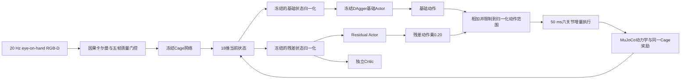

# 冻结基础策略与残差PPO训练链

## 最终控制结构

这条训练链不再让PPO重新学习完整的局部逆运动学。`dagger_04.pt`中的最终专家Actor作为基础控制器永久冻结；新的Residual Actor只学习基础动作上需要补偿的少量关节增量。



18维状态仍是“当前TCP到当前Cage的Base相对位置3维、最短旋转向量3维、关节角6维、关节速度6维”。基础Actor和Residual Actor看到同一个物理状态，但分别使用各自来源checkpoint中冻结的归一化统计。最终动作先计算冻结基础动作，再加上经过缩放的残差动作；默认残差尺度为0.20。程序分别保存基础动作、未缩放残差、相加后的裁剪前动作和实际执行动作，便于发现残差过大或组合动作饱和。

PPO概率比、tanh Jacobian修正、熵与KL只针对Residual Actor产生的残差随机变量。基础动作是确定性的冻结参考，不进入PPO概率比。Actor和Critic使用两个独立优化器；Actor达到KL停止阈值时只停止本轮Actor更新，Critic仍完成其全部训练轮次。

## 三套严格隔离的轨迹

- 专家轨迹：原`dagger_04.pt`所使用的500条轨迹，只用于证明Residual PPO没有复用专家Actor的训练曲线。
- 残差训练轨迹：新的500条准平面曲线，用于Critic重新对齐和Residual PPO rollout。
- checkpoint验证轨迹：新的100条曲线，只用于固定条件下比较基础策略与各个残差checkpoint，不参与梯度更新。周期验证从整个轨迹库等间隔选取20条，而不是只取前20条。
- 最终测试轨迹：再独立生成200条，只在checkpoint确定以后进行最终报告，不用于选择checkpoint。

训练入口会对三套归档中的真实时间戳和真实三维轨迹计算内容指纹。即使文件名、track id或随机种子不同，只要存在完全复用的曲线，训练都会立即拒绝。训练配置与验证配置除随机种子和声明的轨迹数量外必须完全相同；因此状态、奖励、机器人、相机和时间契约不会漂移，而视觉噪声随机序列彼此独立。

## 初始化和正式训练

1. 加载`dagger_04.pt`中的Actor和其状态归一化统计，冻结全部参数。
2. 加载`critic_warmup.pt`中的Critic和残差侧状态归一化统计。程序逐张量确认该文件内的Actor与`dagger_04.pt`完全相同，防止基础策略来源错配。
3. 新建Residual Actor，均值头初始化为零。因此确定性Residual策略在update 0严格退化为基础策略；初始随机标准差较小，只用于探索局部补偿。
4. 使用新的残差训练轨迹、当前归一化Cage奖励和初始残差策略采集8192个transition，对旧Critic重新对齐20轮。旧`critic_warmup.pt`提供较好的价值特征起点，但不会把旧奖励标尺直接当成新标签。
5. 清空Critic对齐阶段的Adam动量，保留对齐后的Critic权重，建立正式且彼此独立的Residual Actor优化器和Critic优化器。
6. 每个rollout仍从C7局部细调状态开始。正式PPO transition只能包含实际执行的“基础动作加残差动作”，IK初始化和训练特权恢复都位于rollout边界之外。
7. 每50个update保存并验证一次；`latest.pt`用于断点恢复。`best_validation.pt`先要求组合策略相对基础策略的奖励、位置误差、姿态误差、联合成功率、碰撞和真实视觉逃逸均不退化，再在通过该门槛的checkpoint中选择平均奖励最高者。若Residual始终没有带来可靠改善，最佳文件会保留update 0的零残差基础策略，而不会强行选择一个退化模型。

奖励始终使用产生当前18维状态的同一个Cage目标评价动作后的TCP，下一视觉帧产生的新Cage只属于下一状态。Residual奖励V2仍将25 mm和8度作为最终联合成功阈值，但用于连续塑形的参考尺度扩大为60 mm和35度，并使用缓慢衰减的反二次质量映射，避免基础策略约50 mm、34度的误差被指数函数全部压到零。位置质量占0.65、姿态质量占0.35，进度权重提高为1.0。每步跟踪项直接使用零到一的正质量，不再减去常数一，因此维持完整轨迹本身有正回报，不会因为提前碰撞或逃逸、少经历若干负奖励步骤而获益。联合达标奖励以及较小的关节限位、速度和动作代价继续保留；接触碰撞是大惩罚，只有相机几何上真正不可见并连续三帧失败才施加视觉逃逸惩罚，人工漏检仍由因果卡尔曼补齐并按既有恢复边界处理。

## checkpoint验证

每次验证都创建两个具有相同轨迹、初始状态、相机噪声种子和执行条件的新环境：

1. 基础策略：只执行冻结DAgger Actor的确定性动作。
2. 组合策略：执行冻结基础动作加当前Residual Actor的确定性残差。

报告保存平均奖励、位置误差均值/P95、姿态误差均值/P95、联合成功率、视觉检测率、有效历史率、碰撞、视觉逃逸、残差大小和组合裁剪率，同时直接计算组合策略相对基础策略的改善。报告同时给出纯平均奖励排名和通过“不劣于基础策略”严格门槛的最佳checkpoint，避免奖励某一项提高掩盖实际位姿精度下降。比较命令还会核对所有checkpoint内实际冻结的基础Actor和基础归一化统计完全一致；不一致的checkpoint不能放在同一张对比表中。update 0时两种确定性策略应完全相同，这是残差实现的首要自检。

若输出为`artifacts/production_curved/residual_ppo.pt`，文件结构为：

```text
artifacts/production_curved/
├── residual_ppo.pt
└── residual_ppo_checkpoints/
    ├── critic_aligned.pt
    ├── latest.pt
    ├── best_validation.pt
    ├── update_0050.pt
    ├── update_0100.pt
    ├── ...
    ├── training_history.jsonl
    ├── validation_history.jsonl
    └── base_validation.json
```

`critic_aligned.pt`、`latest.pt`、周期checkpoint和最佳checkpoint都包含两个优化器，可用于恢复。若从较早checkpoint续训，程序会把比恢复update更新的旧日志原子归档，再从该位置重新记录，避免两条训练分支混在同一历史中。

## 正式命令

现有专家轨迹归档为`artifacts/production_curved/ppo_trajectories.npz`，包含500条原DAgger轨迹。先生成与它严格不同的残差训练、验证和最终测试轨迹：

```bash
python -m cage_system.cli generate-trajectories \
  --config configs/production_curved_residual_ppo.yaml \
  --count 500 \
  --output artifacts/production_curved/residual_train_trajectories.npz

python -m cage_system.cli generate-trajectories \
  --config configs/production_curved_residual_validation.yaml \
  --count 100 \
  --output artifacts/production_curved/residual_validation_trajectories.npz

python -m cage_system.cli generate-trajectories \
  --config configs/production_curved_residual_test.yaml \
  --count 200 \
  --output artifacts/production_curved/residual_test_trajectories.npz
```

开始完整残差训练：

```bash
python -m cage_system.cli train-residual-ppo \
  --config configs/production_curved_residual_ppo.yaml \
  --validation-config configs/production_curved_residual_validation.yaml \
  --cage-checkpoint artifacts/production_curved/cage_point20.pt \
  --base-actor-checkpoint artifacts/production_curved/ppo2_expert_v2_expert_stages/dagger_04.pt \
  --critic-checkpoint artifacts/production_curved/ppo2_expert_v2_expert_stages/critic_warmup.pt \
  --expert-trajectories artifacts/production_curved/ppo_trajectories.npz \
  --trajectories artifacts/production_curved/residual_train_trajectories.npz \
  --validation-trajectories artifacts/production_curved/residual_validation_trajectories.npz \
  --mujoco-model assets/mujoco_menagerie/universal_robots_ur5e/scene_eye_on_hand.xml \
  --tcp-site attachment_site \
  --output artifacts/production_curved/residual_ppo.pt \
  --device auto
```

若EGL初始化失败，只在命令前添加`MUJOCO_GL=osmesa`使用CPU离屏渲染。正常有显卡的服务器优先保留配置中的EGL。

从最近断点恢复时使用完全相同的命令，并增加：

```text
--resume-checkpoint artifacts/production_curved/residual_ppo_checkpoints/latest.pt
```

训练过程中已经自动写入验证历史。也可以在同一固定验证集上重新比较指定checkpoint：

```bash
python -m cage_system.cli evaluate-residual-checkpoints \
  --config configs/production_curved_residual_validation.yaml \
  --cage-checkpoint artifacts/production_curved/cage_point20.pt \
  --validation-trajectories artifacts/production_curved/residual_validation_trajectories.npz \
  --mujoco-model assets/mujoco_menagerie/universal_robots_ur5e/scene_eye_on_hand.xml \
  --tcp-site attachment_site \
  --checkpoints \
    artifacts/production_curved/residual_ppo_checkpoints/critic_aligned.pt \
    artifacts/production_curved/residual_ppo_checkpoints/update_0050.pt \
    artifacts/production_curved/residual_ppo_checkpoints/update_0100.pt \
    artifacts/production_curved/residual_ppo_checkpoints/best_validation.pt \
  --episodes 20 \
  --output artifacts/production_curved/residual_checkpoint_comparison.json \
  --device auto
```

最终模型确定后，把配置改为`configs/production_curved_residual_test.yaml`、轨迹改为`residual_test_trajectories.npz`并将`--episodes`设为200，只运行一次最终测试。这样最终测试不会反过来参与checkpoint选择。

最佳残差checkpoint可直接复用原有可视化推理入口：

```bash
python -m cage_system.cli infer-visualize \
  --config configs/production_curved_residual_test.yaml \
  --cage-checkpoint artifacts/production_curved/cage_point20.pt \
  --ppo-checkpoint artifacts/production_curved/residual_ppo_checkpoints/best_validation.pt \
  --trajectories artifacts/production_curved/residual_test_trajectories.npz \
  --mujoco-model assets/mujoco_menagerie/universal_robots_ur5e/scene_eye_on_hand.xml \
  --tcp-site attachment_site \
  --track-id 0 \
  --max-steps 0 \
  --snapshot-count 8 \
  --output artifacts/production_curved/residual_inference_track0.png \
  --device auto
```
